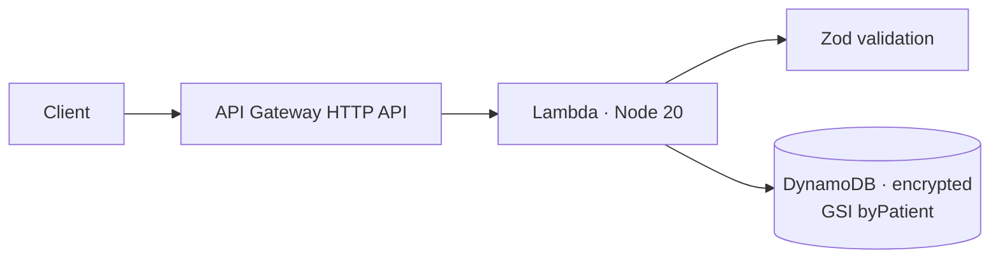

# aws-serverless-api — serverless appointments on AWS CDK

> A **serverless REST API** on **AWS Lambda + API Gateway (HTTP API) + DynamoDB**,
> provisioned entirely with **AWS CDK** (TypeScript). Handlers validate input
> with Zod, persist to DynamoDB, and the stack grants the function
> least-privilege access to an encrypted table.


> ℹ️ An **original reference implementation**. No proprietary code or data.

---

## Architecture



- **Lambda handler** — routes `POST /appointments`, `GET /appointments/{id}`,
  `GET /appointments?patientId=` to a service; validates bodies with Zod.
- **DynamoDB** — table keyed on `id` with a `byPatient` GSI; **encryption at
  rest** and point-in-time recovery enabled (HIPAA-minded defaults).
- **CDK** — one stack defines the table, the `NodejsFunction`, the HTTP API and
  routes, and grants the function **read/write on just that table**.

## API

| Method | Path | Purpose |
| --- | --- | --- |
| `POST` | `/appointments` | Create an appointment (Zod-validated) |
| `GET`  | `/appointments/{id}` | Fetch one (`404` if missing) |
| `GET`  | `/appointments?patientId=` | List a patient's appointments (GSI query) |

---

## Build, test, deploy

```bash
npm install
npm run typecheck   # tsc --noEmit
npm test            # vitest
npm run synth       # cdk synth (CloudFormation)
npx cdk deploy      # needs AWS credentials
```

## Tests

- **Service** — create validates input (rejects bad/non-ISO), assigns id, and
  get/list round-trip (in-memory repo).
- **Repository** — the DynamoDB repository is tested with `aws-sdk-client-mock`:
  `put` sends a `PutCommand`, `get` maps items/null, `listByPatient` queries the
  `byPatient` GSI.
- **Infrastructure** — the CDK stack is synthesized and asserted with
  `Template`: an encrypted table with the GSI, a Lambda, and an HTTP API. No AWS
  account required.

---

## Design decisions

- **Logic, persistence and infra are separable** — service logic tests with an
  in-memory repo, the DynamoDB adapter tests against a mocked client, and the
  stack tests via CloudFormation assertions. None need real AWS.
- **Least privilege by construction** — `table.grantReadWriteData(fn)` scopes IAM
  to exactly what the function needs.
- **Encryption + PITR on by default** — sensible, compliance-minded data
  protection baked into the IaC.

---

*An original reference implementation. No proprietary code or data is included.*
